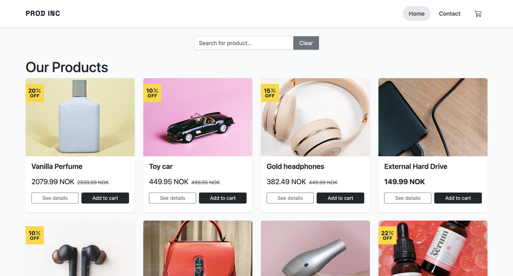

# JS Framework CA


Explore the website by visiting the link: [PROD INC](https://js-frameworkca.netlify.app/)



## Description

PROD INC is an online shop built with React and TypeScript. It was made as a team project for the JavaScript Frameworks course at Noroff, by [Nikita Fedorov](https://www.linkedin.com/in/nikita-fedorov-757aaa402/) and [@AndrewMoisa](https://github.com/AndrewMoisa).

The task was to build a semi working website using modern solutions and knowledge gained throughout the course. All products come from the Noroff Online Shop API. You can browse and search the products, open a product page, add items to the cart and go through a simple checkout. There is no real payment, the checkout confirms the order and empties the cart.

### Features

- Browse product catalogue without logging in
- Search products with URL query, updated when you stop typing
- Paginated product listing, with 10 items per page
- View product details with pricing, discounts, ratings and reviews
- Add or remove products from the cart and change the quantity
- Cart is saved in local storage, so it stays after a refresh
- Cart total calculation, with the discount shown
- Contact form with validation using Zod

## Built With

- Language = TypeScript
- Framework = React 19
- Build Tool = Vite
- Routing = TanStack React Router
- State Management = Zustand
- Forms = React Hook Form + Zod
- Styling = Bootstrap 5 + Bootstrap Icons
- API = Noroff Online Shop API
- Hosting = Netlify

## How It Works

Products come from the Noroff Online Shop API. The route loaders in `routes.tsx` fetch the data before a page opens, and show a spinner while loading or an error message if it fails.
The pages read that data and pass it down to the components. Search and pagination happen in the browser, using `query` and `page` from the URL.
When you add a product to the cart, it goes into the Zustand store in `cartStore.ts`. The header and the cart page both read from that store.
The store is saved in local storage, so the cart is still there after a refresh.

## Project Structure

```
src/
├── components/   # layout, product cards, pagination and ui
├── constants/    # API url
├── pages/        # one file per page
├── schemas/      # Zod schema for the contact form
├── store/        # Zustand cart store
├── styles/
├── types/
├── routes.tsx    # all routes and loaders
└── main.tsx
```

## Getting Started

### Prerequisites

- Node.js (v20.19 or later, Vite 7 needs it)
- npm

You don't need any environment variables. The API url is in `src/constants/api.ts`.

### Installing

1. Clone the repo:

```bash
git clone https://github.com/Nikita-stud/Prod-Inc.git
```

2. Install the dependencies:

```bash
npm install
```

### Running

To run the app, run the following command:

```bash
npm run dev
```

### Available Scripts

- `npm run dev` starts the Vite development server with hot module reloading
- `npm run build` compiles TypeScript and bundles the app for production
- `npm run lint` displays any ESLint errors in JS and TS files
- `npm run preview` serves the production build locally for testing

### Script Details

```json
  "scripts": {
    "dev": "vite",
    "build": "tsc -b && vite build",
    "lint": "eslint .",
    "preview": "vite preview"
  },
```

## Team

- [Nikita Fedorov](https://www.linkedin.com/in/nikita-fedorov-757aaa402/): TBA
- [@AndrewMoisa](https://github.com/AndrewMoisa): TBA

## Roadmap

- [x] Save the cart in local storage
- [x] Show product reviews
- [ ] Sort and filter products
- [ ] Page numbers in the pagination
- [ ] Tests for the cart

## Contributing

This is a finished course project, so we are not planning any big changes. If you find a bug or have an idea, open an issue or a pull request and we will take a look.

## Contact

You can always contact us through the official Noroff portal, or reach us here:

- Nikita on [GitHub](https://github.com/Nikita-stud) and [LinkedIn](https://www.linkedin.com/in/nikita-fedorov-757aaa402/)
- [@AndrewMoisa](https://github.com/AndrewMoisa) on GitHub
